# Piezoelectric Vibration Sensor — Analog Front-End & PCB Design

**Project status:** In progress — LTspice simulation completed for the initial signal chain; EasyEDA Pro schematic and preliminary PCB layout created  
**Design tools:** LTspice · EasyEDA Pro  
**Analog IC:** Analog Devices AD8608 quad CMOS op-amp  
**Power stage:** 78M05B fixed 5 V linear regulator  
**Hardware status:** PCB layout and 3D visualization complete; fabrication, assembly, and physical testing are pending

> **Scope:** An independent electronics design and learning project. Simulation plots are **not physical measurements**. The schematic and PCB shown here are a **design revision**, not a fabricated or electrically validated board.

## Project overview

This project develops an analog front end that converts the charge generated by a piezoelectric vibration sensor into a measurable, filtered voltage. The workflow progresses from circuit calculations and LTspice experiments to a custom schematic and routed PCB in EasyEDA Pro, with hardware validation planned next.

The circuit combines a linear regulated power supply, buffered mid-supply reference, charge amplifier, RC low-pass filter, and final output buffer.

## EasyEDA schematic and PCB design

### Complete schematic

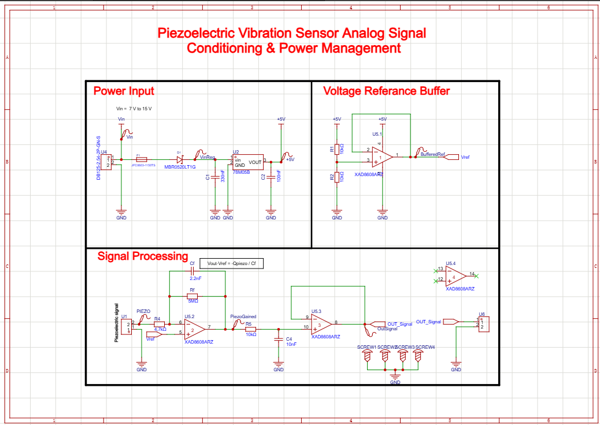

The schematic is organized into three functional sections: **Power Input**, **Voltage Reference Buffer**, and **Signal Processing**.

### Routed PCB layout

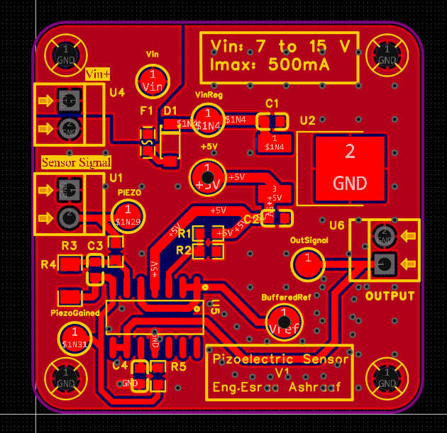

The layout includes the battery input, piezoelectric sensor connector, regulated-supply stage, analog signal-conditioning network, output connector, and test points. **Routing has been created, but ERC/DRC, protection, thermal, and manufacturing readiness are still under review.**

### 3D PCB preview

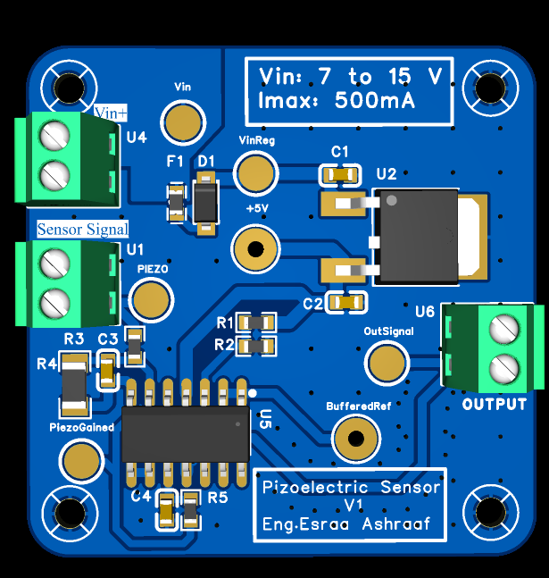

This is a software-generated 3D preview of the designed board—not a photograph of a manufactured PCB.

<details>
<summary><strong>See individual schematic sections</strong></summary>

**Power input**

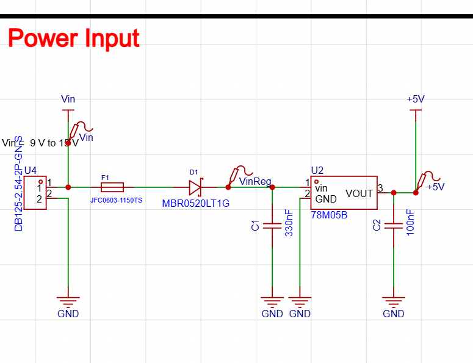

**Buffered voltage reference**

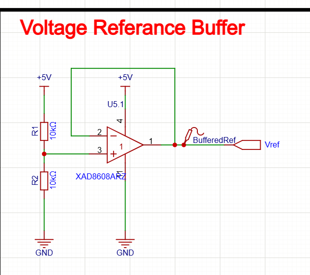

**Analog signal processing**

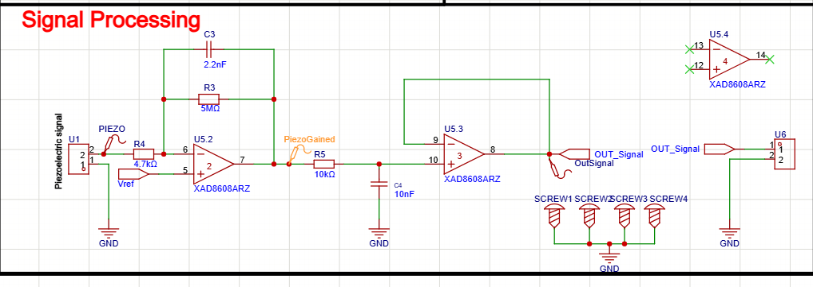

</details>

## System architecture

```text
Battery / DC input (proposed 7–15 V; operating range not yet validated)
                  |
           Fuse + series diode
                  |
          78M05B linear regulator
                  |
               +5 V rail
                  |
           10k / 10k divider
                  |
         U5.1: 2.5 V reference buffer ───────────┐
                                                  |
Piezo sensor -> 4.7k input resistor -> U5.2 charge amplifier
                                         Rf = 5 MΩ || Cf = 2.2 nF
                                                  |
                                         Charge-amplifier output
                                                  |
                                         10k / 10nF RC filter
                                                  |
                                         U5.3 output buffer
                                                  |
                                       Analog output connector
```

**Sensor modeling note:** The LTspice experiments used a simplified sinusoidal current source in parallel with a 480 pF capacitance. This is **not** a calibrated mechanical model of the actual sensor. The sensor's bending, mounting, resonance, and output under real vibration are not yet characterized.

## Design parameters

| Subsystem | Current EasyEDA design | Engineering note |
|---|---|---|
| Battery input | Proposed 7–15 V DC | Actual supported range and input protection must be verified |
| Voltage regulation | 78M05B, nominal 5 V | Dropout and heat dissipation to be validated |
| Supply bypass | 330 nF input, 100 nF output | Per-regulator suitability and op-amp local decoupling to be reviewed |
| Buffered reference | 10 kΩ / 10 kΩ divider, AD8608 | Approximately 2.5 V nominal |
| Sensor | Piezoelectric input connector | Candidate film sensor: TE Connectivity LDT0-028K |
| Input resistor | 4.7 kΩ | Sensor interface and protection review pending |
| Charge amplifier feedback | 5 MΩ in parallel with 2.2 nF | EasyEDA revision; differs from earlier LTspice value of 4.7 MΩ |
| Low-pass section | 10 kΩ and 10 nF | First-order RC filter |
| Output | Buffered analog signal | Intended for oscilloscope or high-impedance acquisition input |
| PCB | Routed two-layer layout and 3D preview | Not fabricated or bench-tested |

## Key equations

**Charge-to-voltage conversion (ideal midband):**

```text
ΔVout ≈ −Qpiezo / Cf
Cf = 2.2 nF  ->  |ΔVout| ≈ 0.455 V per 1 nC
```

**Charge-amplifier feedback corner (EasyEDA revision):**

```text
fL ≈ 1 / (2π Rf Cf)
Rf = 5 MΩ, Cf = 2.2 nF  ->  fL ≈ 14.5 Hz
```

**RC low-pass corner:**

```text
fc = 1 / (2π RC)
R = 10 kΩ, C = 10 nF  ->  fc ≈ 1.59 kHz
```

The charge equation is an ideal approximation valid within the appropriate operating band; the voltage reference and other circuit nonidealities are omitted. The lower cutoff is a theoretical feedback-network value, not a measured mechanical vibration threshold.

## LTspice simulation development

Before the EasyEDA schematic, the analog signal chain was developed and studied in LTspice.

**Earlier LTspice values:** `Rf = 4.7 MΩ`, `Cf = 2.2 nF`, simulated piezoelectric source `I1 = 100 nA peak at 100 Hz`, sensor capacitance `Cs = 480 pF`, input resistor `4.7 kΩ`, and output RC filter `10 kΩ / 10 nF`.

| Test | Simulation observation |
|---|---|
| Voltage divider | `VREF = 2.500 V` from a 5 V supply |
| Reference buffer | `VREF_BUF ≈ 2.49992 V`; approximately 0.25 mA into a 10 kΩ test load |
| Charge amplifier DC point | `CHARGE_OUT ≈ 2.49984 V` before sensor excitation |
| Transient, 100 Hz | Settled output approximately 2.43–2.57 V for the illustrative 100 nA peak input |
| Feedback sensitivity | Reducing `Cf` increased the AC output amplitude |
| AC sweep | 1 Hz–100 kHz response examined; approximately −9.66 dBV read near 15.4 Hz in the original current-driven test |
| RC low-pass | `V(filtered)/V(charge_out)` used to observe filter-only attenuation |

These results apply to the **earlier LTspice design**, not automatically to the newer EasyEDA schematic. In particular, the feedback resistance changed from **4.7 MΩ to 5 MΩ**, so a final matching simulation is still needed.

### LTspice schematic

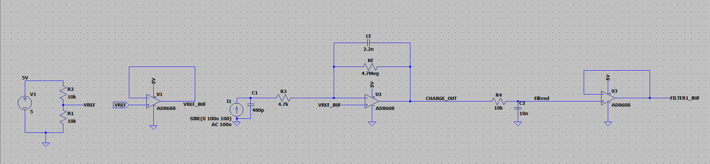

### Transient response

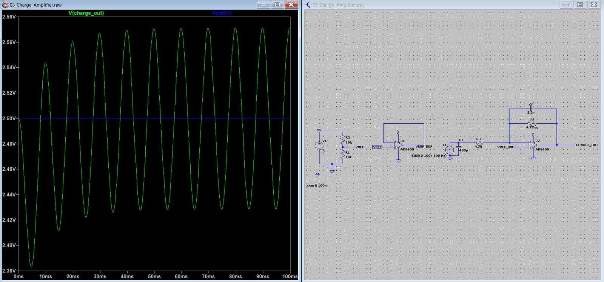

### AC frequency response

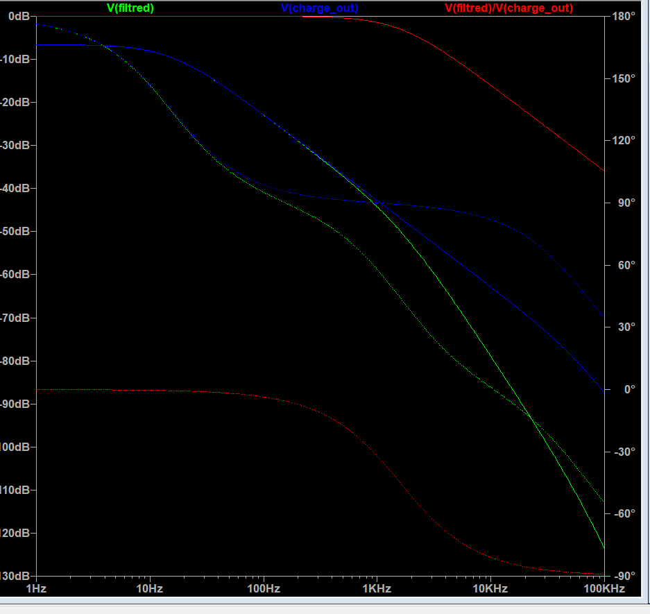

<details>
<summary><strong>Additional simulation evidence</strong></summary>

**Voltage reference operating point**

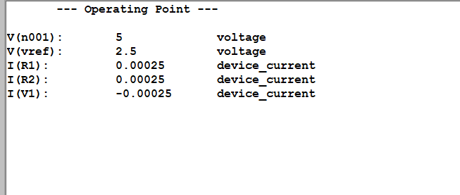

**Buffered-reference load experiment**

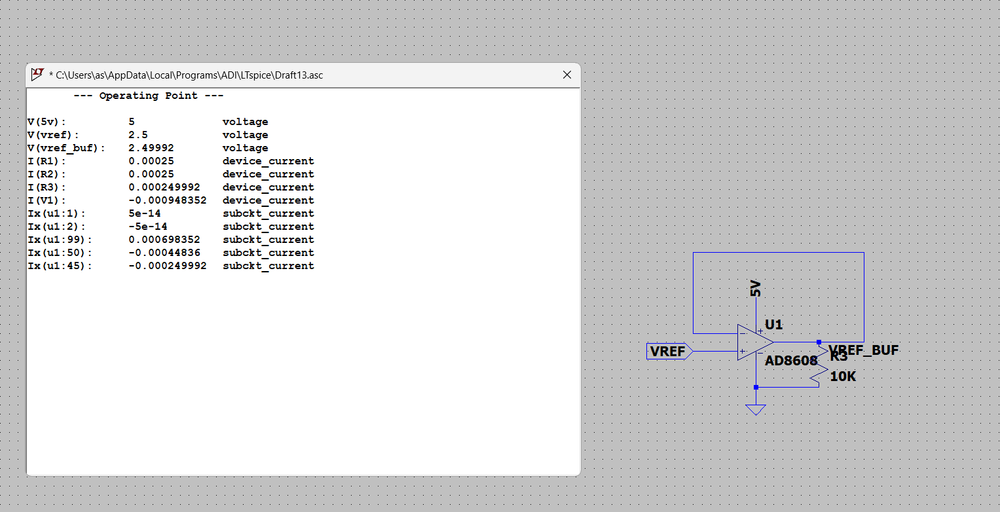

**Feedback-capacitor sensitivity experiment**

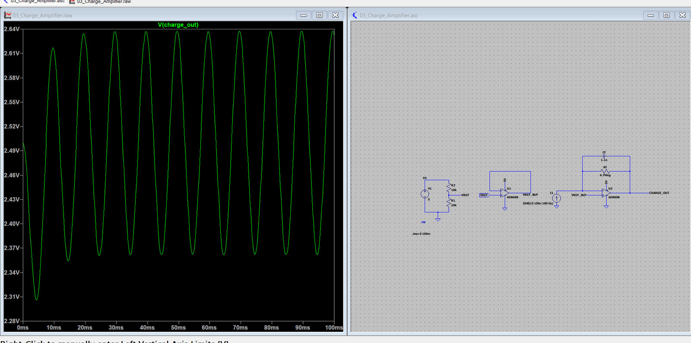

</details>

## Work completed

- [x] Initial LTspice schematic of the reference buffer and charge amplifier
- [x] Simplified piezoelectric electrical source model and transient simulations
- [x] Feedback-capacitance experiment and AC frequency-response investigation
- [x] First-order analog RC filter and output buffer
- [x] EasyEDA Pro schematic with power, reference, and signal sections
- [x] Initial PCB component placement, routing, and ground copper
- [x] 3D PCB visualization and test-point labeling
- [x] Technical documentation and image-based project history

## Pending validation and next steps

- [ ] Align the final EasyEDA schematic with the final LTspice simulation values and verify operation
- [ ] Review unused AD8608 section termination and local supply decoupling
- [ ] Verify the battery voltage range, diode/fuse coordination, regulator dropout, and thermal limits
- [ ] Design and validate safe, low-leakage sensor-input protection
- [ ] Test amplifier stability, noise, output loading, and component tolerances
- [ ] Run schematic electrical-rule check (ERC) and PCB design-rule check (DRC)
- [ ] Export and review manufacturing files and bill of materials (BOM)
- [ ] Fabricate, assemble, and bench-test the PCB with a real piezoelectric sensor

**Design-stage disclaimer:** The current schematic, calculations, and screenshots do not establish safety or manufacturing readiness. The PCB has not been assembled, electrically verified, or calibrated.

## Project files and documentation

- [Editable LTspice schematic](03_Charge_Amplifier.asc)
- [Project requirements](Project_Requirements.md)
- [Engineering log](Engineering_Log.md)
- [Simulation notes](Simulation_Results.md)
- [Validation plan](Validation_Plan.md)
- [Change history](CHANGELOG.md)
- [Source references](References.md)
- [Update workflow](Update_Workflow.md)
- **EasyEDA project source:** export from EasyEDA Pro and add to this repository when ready; screenshots alone are not editable CAD files.

## Technical references

- [Analog Devices — AD8608 operational amplifier](https://www.analog.com/en/products/ad8608.html)
- [Analog Devices — CN0350 piezoelectric signal-conditioning reference](https://www.analog.com/en/resources/reference-designs/circuits-from-the-lab/cn0350.html)
- [TE Connectivity — Piezo film sensor documentation](https://www.te.com/en/product-CAT-PFS0006.html)
- [Analog Devices — LTspice](https://www.analog.com/en/resources/design-tools-and-calculators/ltspice-simulator.html)
- [EasyEDA Pro documentation](https://prodocs.easyeda.com/)

*Manufacturer diagrams, datasheets, and third-party model files retain their respective licenses and should not be redistributed without permission.*
